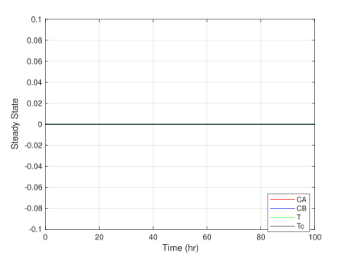
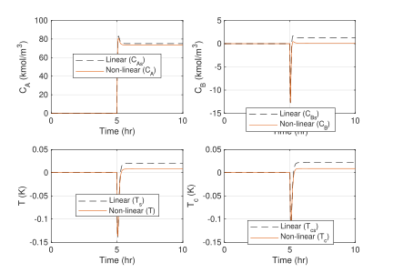
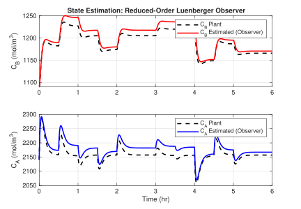
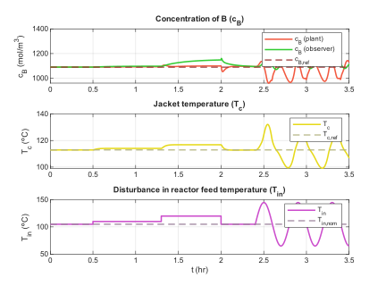

# CSTR-State-Space-Control

State-space control (**LQR + reduced-order Luenberger observer**) of a jacketed benchmark CSTR (**Klatt–Engell** reactor), aiming to operate at the maximum-yield point of the intermediate product B without compromising thermal safety.

All the work is developed in **MATLAB / Simulink**; the animations were generated with **Python (Manim)**.

## Table of contents

- [Repository structure](#repository-structure)
- [Requirements and how to run the project](#requirements-and-how-to-run-the-project)
- [1. Reactor model (`01_Models`)](#1-reactor-model-01_models)
- [2. LQR control and Luenberger observer (`02_Control_and_Observer`)](#2-lqr-control-and-luenberger-observer-02_control_and_observer)
- [3. Integral control experiments (`03_Experiments_Integral_Control`)](#3-integral-control-experiments-03_experiments_integral_control)
- [4. Animations (`04_Animations`)](#4-animations-04_animations)
- [5. Bibliography](#5-bibliography)
- [License](#license)

---

## Repository structure

```text
CSTR-State-Space-Control/
├── 01_Models/
│   ├── Scripts/
│   │   ├── Constants_and_state_space.mlx     # Constants, operating point (fsolve) and linearization (A, B, C, D)
│   │   ├── Generator_models_figures.mlx      # Simulates and generates the linear vs. nonlinear comparison figures
│   │   ├── NonLinear.slx                     # Nonlinear model at the equilibrium point (steady-state check)
│   │   └── NonLinearVsStateSpace.slx         # Nonlinear vs. linear model under step inputs
│   └── Figures/                              # Figures (editable .fig + vector .svg)
├── 02_Control_and_Observer/
│   ├── Scripts/
│   │   ├── Constants_and_state_space.mlx     # (copy) constants and linearization
│   │   ├── FeedbackControl.mlx               # LQR + observer design and figure generation
│   │   ├── Validation_Observer.slx           # Observer validation (nonlinear plant)
│   │   └── LQR_and_Observer.slx              # Closed loop: nonlinear plant + LQR + observer
│   └── Figures/
├── 03_Experiments_Integral_Control/          # Integral action experiments (not part of the final design)
│   ├── Constants_and_state_space.mlx
│   ├── Controlability_to_Integrate_Cb_and_Tc.mlx
│   ├── Cb_IntegralControl.mlx
│   ├── Integral_Control.slx
│   ├── Cb_Integral_Control_Observer.slx
│   └── Tc_Integral_Control_Observer.slx
├── 04_Animations/
│   ├── CSTR animation/
│   │   ├── main_v2.py                        # Manim scene (reactor + plots)
│   │   └── simulink_data.csv                 # Data exported from Simulink that drives the animation
│   ├── JacketedCSTR.mp4
│   └── luenberger_observer_CSTR.mp4
├── LICENSE
└── README.md
```

> Each scripts folder includes its own copy of `Constants_and_state_space.mlx`, so every stage can be run independently.

---

## Requirements and how to run the project

### MATLAB (folders 01, 02 and 03)

- MATLAB with **Simulink** (developed and tested with R2025b).
- Toolboxes: **Control System Toolbox** (`lqr`, `place`, `ctrb`, `obsv`, `ss`), **Symbolic Math Toolbox** (`syms`, `jacobian`) and **Optimization Toolbox** (`fsolve`).

Steps:

1. Clone the repository and open MATLAB.
2. Set MATLAB's current folder to the `Scripts` folder of the stage you want to reproduce (the scripts call each other by name and the `.slx` models are looked up in the current folder).
3. Run the main script of that stage:

| Stage | MATLAB current folder | Script to run | What it does |
|---|---|---|---|
| Model | `01_Models/Scripts` | `Generator_models_figures.mlx` | Computes the operating point, linearizes, simulates `NonLinear.slx` and `NonLinearVsStateSpace.slx` and saves the figures |
| Control + observer | `02_Control_and_Observer/Scripts` | `FeedbackControl.mlx` | Computes `K` (LQR) and `L` (observer), validates the observer (`Validation_Observer.slx`) and simulates the closed loop (`LQR_and_Observer.slx`) |
| Integral | `03_Experiments_Integral_Control` | `Controlability_to_Integrate_Cb_and_Tc.mlx` / `Cb_IntegralControl.mlx` | Controllability check and integral-action design; then the `.slx` files in the folder are simulated |

Figures are saved with `savefig` in the current folder; to obtain a vector version from a `.fig`:

```matlab
f = openfig('Figures/JacketedCSTR.fig', 'invisible');
saveas(f, 'JacketedCSTR.svg');                              % SVG
exportgraphics(f, 'JacketedCSTR.pdf', 'ContentType', 'vector');  % vector PDF
```

### Animations (folder 04)

- Python ≥ 3.10 (tested with 3.13), [Manim Community](https://www.manim.community/), `numpy` (and `scipy` only if data is read from `.mat` files) and a **LaTeX** installation (the labels use `MathTex`/`Tex`).

```bash
pip install manim numpy
cd "04_Animations/CSTR animation"
manim -pqh main_v2.py JacketedCSTR
```

The scene reads `simulink_data.csv` (columns `t, cA, cB, T, Tc, QinV, QH, cAin, Tin, cBhat`) from the working directory; if it does not exist, it generates a demo simulation.

---

## 1. Reactor model (`01_Models`)

### 1.1 The reactor

The model is a **continuous stirred-tank reactor (CSTR)** with constant volume, liquid phase, a cooling jacket and an external heat exchanger (Klatt–Engell benchmark model, taken from Hajaya & Shaqarin, 2019). CSTRs are very common units in continuous production, and this case is a classic benchmark for testing nonlinear and multivariable control strategies.

The reactor produces **cyclopentenol (B)** from **cyclopentadiene (A)** through an acid-catalyzed electrophilic addition of water in dilute solution. **Cyclopentanediol (C)** and **dicyclopentadiene (D)** appear as by-products. The reaction scheme is:

$$
A \xrightarrow{k_1} B \xrightarrow{k_1} C \qquad \text{(in series)}
$$

$$
2A \xrightarrow{k_2} D \qquad \text{(in parallel)}
$$

**Why is this reactor so hard to optimize?**

- **Series reaction (A → B → C).** B is an *intermediate*: if the residence time or temperature is too low, A is left unconverted; if too high, B keeps being consumed towards C. The yield of B therefore goes through an **interior maximum** and does not grow monotonically with any input.
- **Parallel reaction (2A → D).** It is **second order** in A, so it is favored by high concentrations of A, and it is **strongly exothermic** (ΔH ≈ −41.85 kJ/mol), which tightly couples composition and temperature.
- **Temperature sensitivity (Arrhenius).** Both rate constants depend exponentially on temperature with different activation energies (E₁ = −9758.3 K, E₂ = −8560 K), so any temperature change shifts the rate of all three reactions at once and, with it, the selectivity towards B.
- **Narrow operating window.** The maximum-yield point of B (c_B ≈ 1090 mol/m³, yield ≈ 0.516) requires a precise trade-off between feed flow rate (Q_in/V) and removed heat (Q_H) within physical constraints.

### 1.2 Nonlinear model

State variables, manipulated inputs and disturbances:

| Vector | Symbol | Variables | Units |
|---|---|---|---|
| States | $x = [c_A,\; c_B,\; T,\; T_c]^T$ | concentration of A and B in the reactor, reactor and jacket temperature | mol/m³, mol/m³, °C, °C |
| Inputs | $u = [Q_{in}/V,\; Q_H]^T$ | feed flow rate normalized by volume and heat removed by the jacket | 1/h, kJ/h |
| Disturbances | $d = [c_{A,in},\; T_{in}]^T$ | feed concentration and feed temperature | mol/m³, °C |
| Controlled outputs | $y_c = [c_B,\; T_c]^T$ | concentration of B and jacket temperature | mol/m³, °C |

Mass and energy balances (time in hours):

$$
\frac{dc_A}{dt} = \frac{Q_{in}}{V}\,(c_{A,in} - c_A) - k_1 c_A - k_2 c_A^2
$$

$$
\frac{dc_B}{dt} = -\frac{Q_{in}}{V}\,c_B + k_1\,(c_A - c_B)
$$

$$
\frac{dT}{dt} = \frac{Q_{in}}{V}\,(T_{in} - T) - \frac{1}{\rho\, C_p}\left(k_1 c_A \Delta H_{AB} + k_1 c_B \Delta H_{BC} + k_2 c_A^2 \Delta H_{AD}\right) + \frac{A_R K_W}{\rho\, C_p\, V}\,(T_c - T)
$$

$$
\frac{dT_c}{dt} = \frac{Q_H}{m_K C_{PJ}} + \frac{A_R K_W}{m_K C_{PJ}}\,(T - T_c)
$$

with the Arrhenius rate constants:

$$
k_i = k_i^0 \exp\!\left(\frac{E_i}{T + 273.15}\right), \qquad i = 1, 2
$$

<details>
<summary><b>Model parameters</b></summary>

| Symbol | Description | Value |
|---|---|---|
| $V$ | Reactor volume | 0.01 m³ |
| $C_p$ | Heat capacity of the liquid phase | 3.01 kJ/(kg·K) |
| $\rho$ | Density of the liquid phase | 934.2 kg/m³ |
| $\Delta H_{AB}$ | Enthalpy of reaction A → B | 4.2 kJ/mol A |
| $\Delta H_{BC}$ | Enthalpy of reaction B → C | −11.0 kJ/mol B |
| $\Delta H_{AD}$ | Enthalpy of reaction 2A → D | −41.85 kJ/mol A |
| $A_R$ | Jacket heat-exchange area | 0.215 m² |
| $K_W$ | Jacket heat-transfer coefficient | 4032 kJ/(h·K·m²) |
| $m_K$ | Coolant mass | 5 kg |
| $C_{PJ}$ | Coolant heat capacity | 2.0 kJ/(kg·K) |
| $k_1^0$ | Collision factor of reaction 1 | 1.287·10¹² 1/h |
| $k_2^0$ | Collision factor of reaction 2 | 9.043·10⁶ m³/(mol·h) |
| $E_1,\ E_2$ | Activation energies (divided by R) | −9758.3 K, −8560 K |

</details>

**Operating point (maximum yield of B)**, obtained with `fsolve` for $Q_{in}/V = 14.19$ 1/h, $Q_H = -1113.5$ kJ/h, $c_{A,in} = 5100$ mol/m³ and $T_{in} = 104.9$ °C:

| $c_{A,s}$ | $c_{B,s}$ | $T_s$ | $T_{c,s}$ |
|---|---|---|---|
| 2140.2 mol/m³ | 1090.3 mol/m³ | 114.19 °C | 112.91 °C |

The following figure checks that, starting from that point with no disturbance, the deviation variables stay at zero (the point is indeed an equilibrium):

<p align="center">
  
</p>

### 1.3 Linearized state-space model

The model is linearized around the operating point using the Jacobian (symbolic `jacobian` in `Constants_and_state_space.mlx`). With the deviation variables $\tilde{x} = x - x_s$, $\tilde{u} = u - u_s$ and $\tilde{d} = d - d_s$:

$$
\dot{\tilde{x}} = A\,\tilde{x} + B\,\tilde{u} + B_d\,\tilde{d}, \qquad \tilde{y} = C\,\tilde{x} + D\,\tilde{u}
$$

$$
A = \left.\frac{\partial f}{\partial x}\right|_s,\quad
B = \left.\frac{\partial f}{\partial u}\right|_s,\quad
B_d = \left.\frac{\partial f}{\partial d}\right|_s,\quad
C = I_4,\quad D = 0
$$

Numerical values (rounded):

$$
A = \begin{bmatrix}
-38.702 & 0 & -2648.1 & 0\\
14.736 & -28.926 & 1006.3 & 0\\
0.12348 & 0.057646 & -35.111 & 30.829\\
0 & 0 & 86.688 & -86.688
\end{bmatrix}
\qquad
B = \begin{bmatrix}
2959.8 & 0\\
-1090.3 & 0\\
-9.2911 & 0\\
0 & 0.1
\end{bmatrix}
\qquad
B_d = \begin{bmatrix}
14.19 & 0\\
0 & 0\\
0 & 14.19\\
0 & 0
\end{bmatrix}
$$

Eigenvalues of $A$: $-117.81,\ -37.44,\ -20.52,\ -13.66$ (in 1/h).

### 1.4 Linear vs. nonlinear comparison

Steps are applied to the inputs (at $t = 5$ h) and the response of the linear model (dashed line) is compared with that of the nonlinear model (solid line), both in deviation variables:

<p align="center">
  
</p>

The linear model reproduces the dynamics and the final value well for small deviations; the steady-state discrepancy grows with the size of the disturbance, because the nonlinear model includes terms (Arrhenius, $c_A^2$) that the linearized model neglects.

### 1.5 Why control a system that is already stable?

All eigenvalues of $A$ have negative real part, so **the open-loop system is stable** (locally). Control is still needed because:

1. **It does not settle at the point we want.** After input changes or disturbances, the reactor settles at a *different* equilibrium than the maximum-yield point of B; in open loop nothing brings it back to the optimum.
2. **Stability is only local.** When disturbances are large the nonlinearities come into play (exponential Arrhenius dependence, quadratic term in $c_A$, thermal coupling) and the system can become **unstable**.

---

## 2. LQR control and Luenberger observer (`02_Control_and_Observer`)

### 2.1 Control strategy

A **state-feedback LQR regulator** is designed on the linearized model and, since only $T$ and $T_c$ are measured, a **reduced-order Luenberger observer** estimates the unmeasured concentrations $c_A$ and $c_B$. The controller acts on the **nonlinear** plant (in deviation variables, with actuator saturation: $5 \le Q_{in}/V \le 35$ 1/h and $-8500 \le Q_H \le 0$ kJ/h).

```text
 reference ──► Kr ──►(+)──► nonlinear plant ──► T, Tc (measured)
                       ▲ −K x̂        │
                       │             ▼
                       └──── reduced-order observer ◄── u, T, Tc
                              x̂ = [ĉA, ĉB, T, Tc]
```

### 2.2 Brief theory

**State feedback.** For $\dot{x} = Ax + Bu$ with the control law $u = -Kx$, the closed-loop system is $\dot{x} = (A - BK)x$; the matrix $K$ sets the closed-loop pole locations. To track a reference $r$, a precompensation gain is added: $u = -K\hat{x} + K_r\, r$, with $K_r = \left[\mathrm{dcgain}\left(A-BK,\,B,\,C_{ref}\right)\right]^{-1}$, where $C_{ref}$ selects the controlled variables $(c_B, T_c)$.

**LQR.** It minimizes the cost functional

$$
J = \int_0^\infty \left(\tilde{x}^T Q\, \tilde{x} + \tilde{u}^T R\, \tilde{u}\right)\,dt
$$

whose solution is $K = R^{-1}B^T P$, where $P$ solves the algebraic Riccati equation $A^TP + PA - PBR^{-1}B^TP + Q = 0$. In MATLAB: `K = lqr(A,B,Q,R)`.

**Choice of $Q$ and $R$ (Bryson's rule).** Each term is normalized by the square of its maximum admissible value: $Q_{ii} = 1/x_{i,max}^2$, $R_{jj} = 1/u_{j,max}^2$ (with an extra ×100 penalty on $c_B$ and $T_c$, the controlled variables):

$$
Q = \mathrm{diag}\!\left(\tfrac{1}{2140^2},\ \tfrac{100}{1090^2},\ \tfrac{1}{114.2^2},\ \tfrac{100}{109^2}\right),\qquad
R = \mathrm{diag}\!\left(\tfrac{1}{35^2},\ \tfrac{1}{8500^2}\right)
$$

which gives the gain (rows: $Q_{in}/V$ and $Q_H$; columns: $c_A, c_B, T, T_c$):

$$
K = \begin{bmatrix}
0.0122 & -0.2375 & -0.6731 & -0.1132\\
0.8971 & 0.5201 & 296.63 & 374.78
\end{bmatrix}
$$

with closed-loop poles at $-354.8,\ -142.6,\ -25.7,\ -5.13$.

**Reduced-order Luenberger observer.** The system is controllable (rank 4) and observable with sensors on $T$ and $T_c$ only (rank 4). The state is partitioned into the measured part $x_m = [T, T_c]^T$ and the part to be estimated $x_r = [c_A, c_B]^T$:

$$
\dot{x}_r = A_{11}x_r + A_{12}x_m + B_{u1}u + B_{d1}d, \qquad
\dot{x}_m = A_{21}x_r + A_{22}x_m + B_{u2}u + B_{d2}d
$$

and $x_r$ is estimated by choosing $L$ so that $A_{11} - L A_{21}$ has the desired poles:

$$
\dot{z} = (A_{11}-LA_{21})\,\hat{x}_r + (A_{12}-LA_{22})\,x_m + (B_{u1}-LB_{u2})\,u + (B_{d1}-LB_{d2})\,d,\qquad \hat{x}_r = z + L\,x_m
$$

(the full block implementation is in `Validation_Observer.slx` and `LQR_and_Observer.slx`). The observer poles are placed (`place`) 2.5 times faster than the two slowest poles of $A$: $-51.3$ and $-34.1$, which gives

$$
L = \begin{bmatrix} 160.3 & 0\\ -34.5 & 0 \end{bmatrix}
$$

### 2.3 Observer validation

The observer is validated on the nonlinear plant by applying step disturbances (CA_in and T_in). It estimates the dynamics of $c_A$ and $c_B$ reasonably well, with a small residual steady-state error caused by the mismatch between the observer's linear model and the nonlinear plant:

<p align="center">
  
</p>

### 2.4 Closed-loop results and disturbances

- **Disturbance in $c_{A,in}$ (linear):** the control works correctly. $c_{A,in}$ enters the model linearly (through $\tfrac{Q_{in}}{V}\,c_{A,in}$), so the linearized model represents it well and both the LQR and the observer remain valid.
- **Large disturbance in $T_{in}$:** the control **stops working properly**. Temperature affects the model through the Arrhenius exponentials, so the nonlinearities make the **LQR no longer well tuned** (the gain was computed for the linearized model) and cause **the observer to stop estimating the concentrations correctly**. Since that wrong estimate is **fed back to the controller** ($u = -K\hat{x}$), the observer error propagates into the control loop and degrades the regulation even further.

The figure shows the closed loop with $T_{in}$ steps (+5 °C and +15 °C) and finally a large-amplitude sinusoidal disturbance. The estimate $\hat{c}_B$ is seen drifting away from $c_B$ and, with the large disturbance, the controlled variables oscillate around the reference:

<p align="center">
  
</p>

---

## 3. Integral control experiments (`03_Experiments_Integral_Control`)

Folder of **experiments** (not part of the final design). Integral action was tried in order to remove the steady-state error, by augmenting the state with the integral of the error of the controlled variables:

$$
A_{au} = \begin{bmatrix} A & 0 \\ C_{ref} & 0 \end{bmatrix},\qquad
B_{au} = \begin{bmatrix} B \\ 0 \end{bmatrix}
$$

- **Integrator on both $c_B$ and $T_c$** (`Controlability_to_Integrate_Cb_and_Tc.mlx`): the augmented system is **not fully controllable** (controllability matrix rank 5 < 6), so an integrator cannot be applied to both variables simultaneously.
- **Integrator on $c_B$ only** (`Cb_IntegralControl.mlx`, `Cb_Integral_Control_Observer.slx`, `Tc_Integral_Control_Observer.slx`): the augmented system is controllable (rank 5 = 5), but **with large disturbances the error does not go to zero**: the integrator acts on the $c_B$ value provided by the observer, which is wrong when the nonlinearities degrade the estimate, so a false error is being integrated.

---

## 4. Animations (`04_Animations`)

Animations of the reactor and the simulated responses (data exported from Simulink and rendered with Manim), published on LinkedIn:

| Animation | File | LinkedIn post |
|---|---|---|
| Jacketed reactor with LQR + observer control under $T_{in}$ disturbances | [`JacketedCSTR.mp4`](04_Animations/JacketedCSTR.mp4) | [🔗 Link pending](https://www.linkedin.com/PLACEHOLDER-POST-1) |
| Luenberger observer in the CSTR | [`luenberger_observer_CSTR.mp4`](04_Animations/luenberger_observer_CSTR.mp4) | [🔗 Link pending](https://www.linkedin.com/PLACEHOLDER-POST-2) |

The reactor animation code is in [`04_Animations/CSTR animation/main_v2.py`](<04_Animations/CSTR animation/main_v2.py>) (see [how to run it](#animations-folder-04)).

---

## 5. Bibliography

Asher, G. M., Blasco-Giménez, R., & Martínez-Turégano, J. (2025). *State space fundamentals*. Universitat Politècnica de València. https://riunet.upv.es/server/api/core/bitstreams/17febf40-e648-4ce5-b5fc-1ff98af0a1e6/content

Hajaya, M., & Shaqarin, T. (2019). Control of a benchmark CSTR using feedback linearization. *Jordanian Journal of Engineering and Chemical Industries, 2*(3), 67–75. https://doi.org/10.48103/jjeci292019

Hong, Q.-R., Chan, P.-I., Sou, W.-K., Gong, C., & Lam, C.-S. (2022). Linear quadratic regulator optimal control with integral action (LQRIC) for LC-coupling hybrid active power filter. *Applied Sciences, 12*(19), Article 9772. https://doi.org/10.3390/app12199772

MathWorks. (n.d.). *lqr: Linear-quadratic regulator (LQR) design* [Documentation]. https://www.mathworks.com/help/control/ref/lti.lqr.html

MathWorks. (n.d.). *lqi: Linear-quadratic-integral (LQI) control* [Documentation]. https://es.mathworks.com/help/control/ref/ss.lqi.html

Ogata, K. (2010). *Modern control engineering* (5th ed.). Prentice Hall.

Seborg, D. E., Edgar, T. F., Mellichamp, D. A., & Doyle, F. J., III. (2011). *Process dynamics and control* (3rd ed.). Wiley.

Skogestad, S., & Postlethwaite, I. (2005). *Multivariable feedback control: Analysis and design* (2nd ed.). Wiley.

---

## License

Distributed under the [MIT](LICENSE) license.
